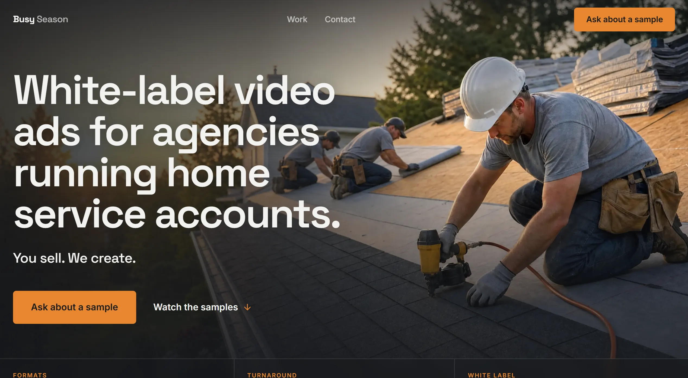
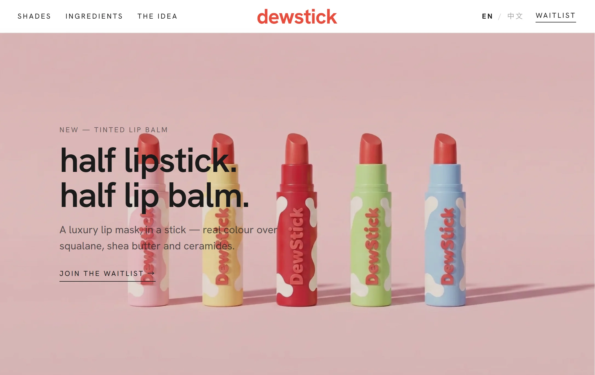
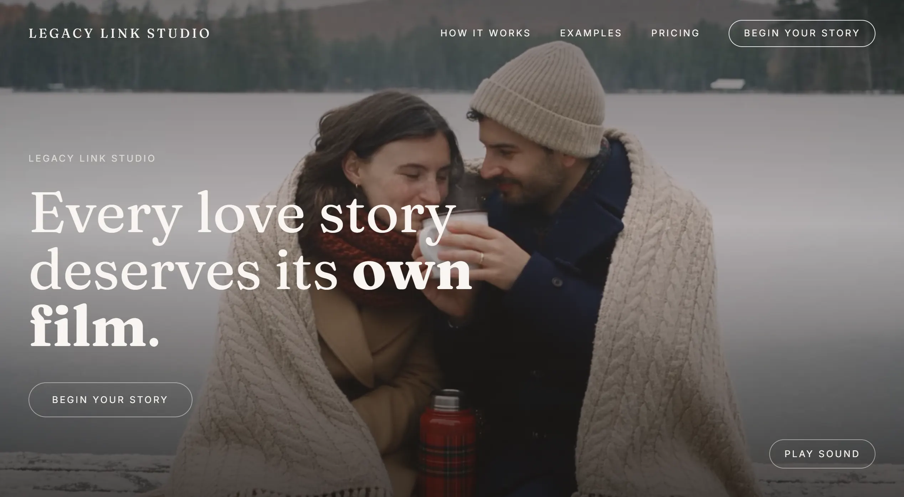
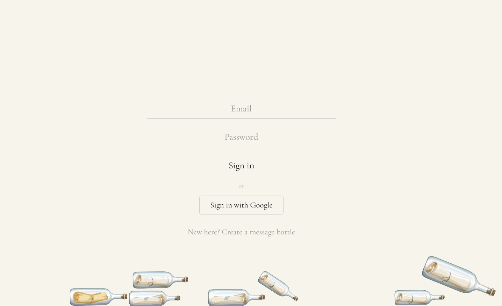

# Hi, I'm Jolin 👋

Web designer and front-end developer in Oshawa, Ontario, studying Computer
Programming at Durham College. I design and build websites that look great,
feel intuitive, and work on every screen. Each project below is live and
built end to end: product idea, design, code and deploy.

**Open to web design and front-end opportunities.**
[Portfolio](https://jolin-ma.github.io/Portfolio/) · [Get in touch](https://jolin-ma.github.io/Portfolio/#contact)

## Featured work

<table>
  <tr>
    <td width="50%" valign="top">
      
      <h3><a href="https://github.com/Jolin-ma/Busy-Season">Busy Season</a></h3>
      White-label short-form video ads for marketing agencies running home service accounts.  
      HTML · CSS · JavaScript · Formspree · Vercel 
      <a href="https://www.busyseason.ca">Live site ↗</a>
    </td>
    <td width="50%" valign="top">
      
      <h3><a href="https://github.com/Jolin-ma/dewstick">dewstick</a></h3>
      A tinted lip balm brand, end to end: a bilingual (EN / 中文) storefront with a working cart, plus a custom Shopify theme.  
      Shopify Liquid · Tailwind · Python · Vercel 
      <a href="https://dewstick.vercel.app">Live site ↗</a>
    </td>
  </tr>
  <tr>
    <td width="50%" valign="top">
      
      <h3><a href="https://github.com/Jolin-ma/legacy-link-studio">Legacy Link Studio</a></h3>
      60–90 second cinematic love story films made from a couple's own footage, delivered as a private capsule link that unlocks on a chosen date.  
      Next.js · React · TypeScript · Tailwind · Framer Motion 
      <a href="https://legacylinkstudio.com">Live site ↗</a>
    </td>
    <td width="50%" valign="top">
      
      <h3><a href="https://github.com/Jolin-ma/Msg-In-A-Bottle">Msg In A Bottle</a></h3>
      A physics-based digital diary: what you type breaks into letters that fall and pile up. Share a private link and keep the pile growing together.  
      Next.js · React · TypeScript · Matter.js · Prisma · PostgreSQL 
      <a href="https://www.msg-in-a-bottle.com">Live app ↗</a>
    </td>
  </tr>
</table>

## What I work with

- **Front end:** HTML, CSS, JavaScript, TypeScript, React, Next.js, Tailwind CSS, Framer Motion
- **E-commerce:** Shopify (Online Store 2.0 themes, Liquid)
- **Back end & data:** Next.js route handlers, Prisma, PostgreSQL, Supabase, Auth.js
- **Shipping:** Vercel, Git & GitHub, Formspree, Resend
- **Design:** UI / UX, responsive layouts, design systems
